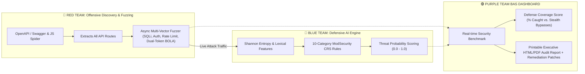

# Purple-Team API Security & AI Threat Detection Platform (BAS)

[](https://www.python.org)
[](https://fastapi.tiangolo.com)
[](https://react.dev)
[](https://owasp.org/API-Security/)
[](https://www.gnu.org/licenses/agpl-3.0)

> **Unified Breach & Attack Simulation (BAS) & AI Threat Intelligence Platform** — Pairs an automated OpenAPI/Web crawler & OWASP vulnerability fuzzer (Red Team) with a real-time ModSecurity CRS + Shannon Entropy detection engine (Blue Team) to measure defense coverage and highlight security blind spots.

---

## Architecture Overview



---

## Key Capabilities

### 1. 🕷️ Automated Attack Surface Discovery
- **OpenAPI / Swagger Parser**: Automatically probes common spec paths (`/openapi.json`, `/swagger.json`, `/v3/api-docs`) and extracts routes, HTTP methods, parameters, and auth scopes.
- **JavaScript & HTML Web Spider**: Crawls web applications and inspects client-side JavaScript bundles to discover hidden `/api/...` endpoints.

### 2. 🛡️ Perimeter WAF & Security Header Fingerprinting
- **Edge WAF Detection**: Fingerprints Cloudflare, AWS WAF, Akamai, F5 BIG-IP, and Imperva.
- **CORS Misconfiguration Auditor**: Probes for arbitrary `Origin` reflection and unsafe wildcard + credentials configurations.
- **Security Headers Grade**: Checks for HSTS, CSP, X-Frame-Options, and X-Content-Type-Options.

### 3. 👥 Dual-Token BOLA Engine (OWASP API1:2023)
- Accepts **Token A (Victim)** and **Token B (Attacker)**.
- Replays Victim's private requests using Attacker's credentials to prove horizontal privilege escalation across tenant boundaries.

### 4. 🤖 Defensive AI Threat Engine
- **10-Category ModSecurity Rule Engine**: Detects SQLi, XSS, Command Injection, Log4Shell, SSRF, Path Traversal, XXE, CRLF Injection, Open Redirect, and Double-Encoding evasion.
- **Shannon Entropy Analysis**: Flags obfuscated payloads and anomalous high-entropy tokens.
- **Verdict Classification**: Distinguishes between **`CAUGHT_BY_AI`** and **`STEALTH_BYPASS`** (logic flaws/BOLA that bypass traditional regex filters).

### 5. 📄 Executive Reporting & Developer Remediation
- Generates branded, printable **HTML/PDF Security Assessment Reports** featuring CVSS severity badges, WAF telemetry, and copy-pasteable Python/FastAPI mitigation patches.

---

## Quick Start

### Windows (One-Click)
Double-click `run.bat` or execute in PowerShell:
```powershell
.\run.bat
```

### Linux / Git Bash
```bash
chmod +x run.bash
./run.bash
```

### Manual Setup

1. **Backend:**
   ```bash
   cd backend
   python -m venv ../.venv
   # Activate venv and install dependencies from pyproject.toml
   uvicorn main:app --reload --host 127.0.0.1 --port 8000
   ```
2. **Frontend:**
   ```bash
   cd frontend
   npm install
   npm run dev
   ```

Visit **`http://localhost:5173`** in your browser.
- **Default Admin Account:** `admin@example.com` / `AdminPassword123` (or register a new account).
- **Swagger API Docs:** `http://127.0.0.1:8000/docs`

---

## Tech Stack
- **Backend:** Python 3.13+, FastAPI, SQLAlchemy, Asyncio, HTTPX, Pydantic
- **Frontend:** React 19, TypeScript, Vite, TanStack Query, Zustand
- **Database:** SQLite (local dev) / PostgreSQL (production)
